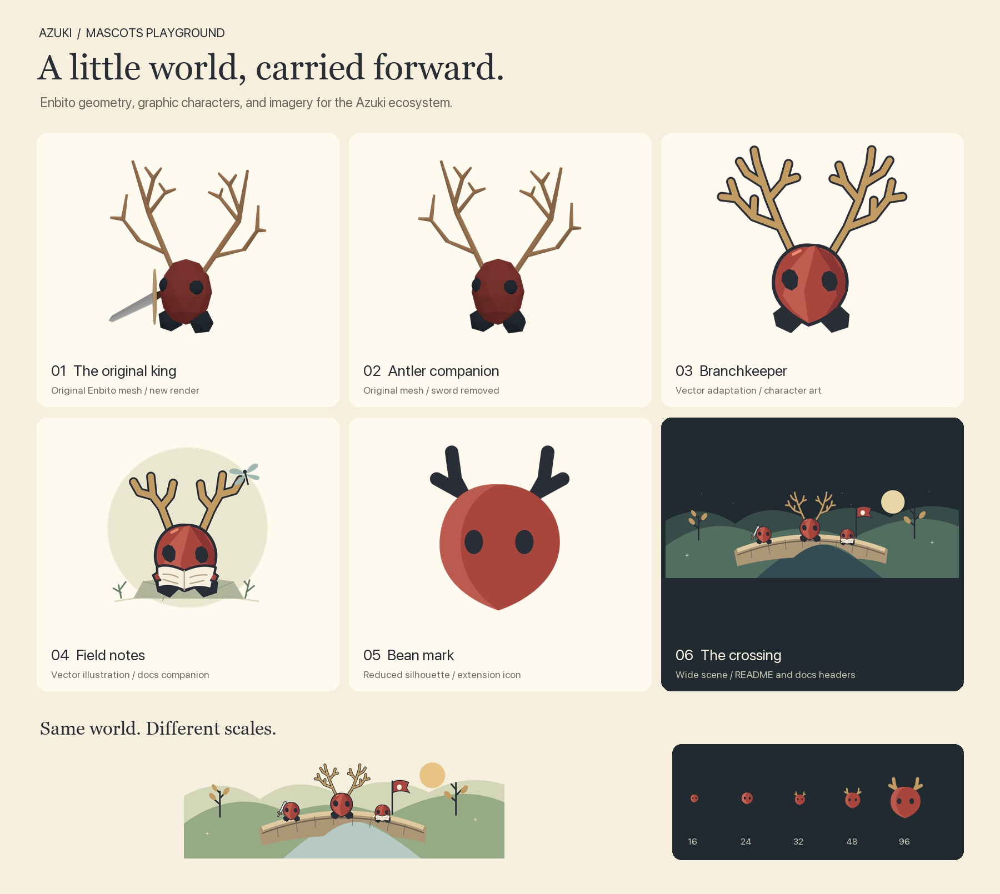
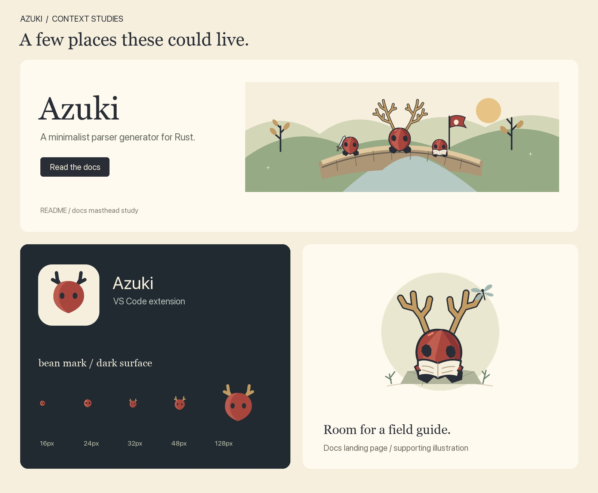
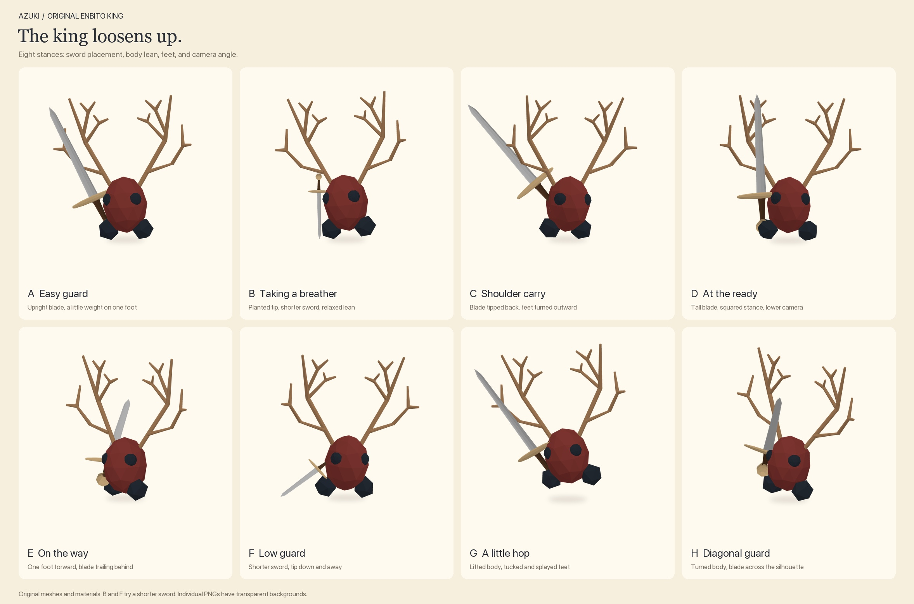
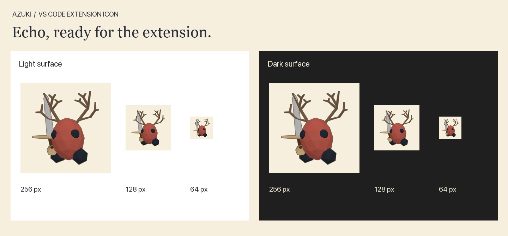
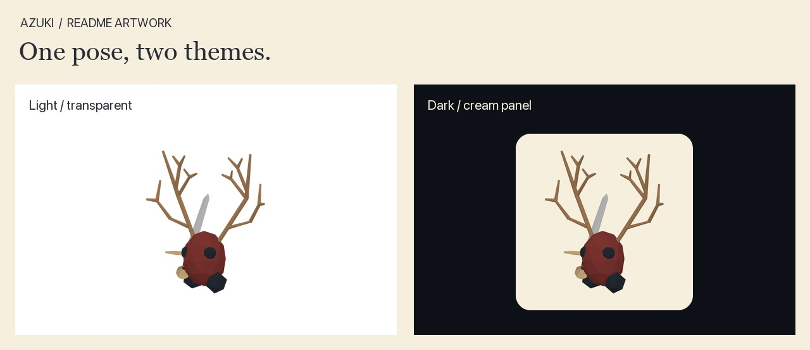

# Mascots playground

Visual experiments for the Azuki ecosystem, inspired by the bean characters in
Enbito (2023). Echo's walking pose has been adopted for the repository README and
adapted into the VS Code extension icon; the other studies remain candidates to
compare.



## Browse the experiments

| Study            | What it explores                                                                                                            | Assets                                                                                                                                         |
| ---------------- | --------------------------------------------------------------------------------------------------------------------------- | ---------------------------------------------------------------------------------------------------------------------------------------------- |
| Original king    | Enbito's actual antlered king, with its sword and original materials, rendered from the copied game geometry.               | [PNG](png/01_enbito_king.png)                                                                                                                  |
| Spear carrier    | The original long-spear character.                                                                                          | [PNG](png/02_enbito_spear.png)                                                                                                                 |
| Antler companion | The original king with the sword hidden.                                                                                    | [PNG](png/03_antler_companion.png)                                                                                                             |
| Little bean      | The original bean, eyes, and feet with both sword and antlers hidden.                                                       | [PNG](png/04_little_bean.png)                                                                                                                  |
| Branchkeeper     | A vector interpretation retaining the oversized branching antlers, faceted red body, black eyes, and chunky feet.           | [SVG](svg/05_branchkeeper.svg), [PNG](png/05_branchkeeper.png), [sword variant](svg/05_branchkeeper_sword.svg)                                 |
| Field notes      | A book-reading companion, with shorter antlers, a rock, plants, and a dragonfly. The book and hands are new additions.      | [SVG](svg/06_field_notes.svg), [PNG](png/06_field_notes.png)                                                                                   |
| Bean mark        | A compact face and antlers for icons. Includes a gold-antler version for dark backgrounds and a cream tile.                 | [SVG](svg/07_bean_mark.svg), [dark-surface SVG](svg/07_bean_mark_dark.svg), [tile PNG](png/07_bean_tile.png)                                   |
| The crossing     | Three bean companions and a banner crossing a bridge. Wide artwork for a README or docs header, without embedded lettering. | [day SVG](svg/08_bridge_day.svg), [day PNG](png/08_bridge_day.png), [night SVG](svg/08_bridge_night.svg), [night PNG](png/08_bridge_night.png) |



## King pose experiments

The second round keeps the original Enbito king and tries different sword
positions, body leans, foot placements, and camera angles. A, C, D, E, G, and H
keep the original sword dimensions. B and F scale the whole sword down to try
more relaxed resting positions. All eleven individual exports are transparent
1536 × 1536 PNGs in `png/poses/`.



| Pose                  | PNG                                                              |
| --------------------- | ---------------------------------------------------------------- |
| A — Easy guard        | [Upright blade, weight on one foot](png/poses/a_easy_guard.png)  |
| B — Taking a breather | [Planted tip and shorter sword](png/poses/b_planted_rest.png)    |
| C — Shoulder carry    | [Blade tipped back](png/poses/c_shoulder_carry.png)              |
| D — At the ready      | [Tall blade and wider stance](png/poses/d_raised_guard.png)      |
| E — On the way        | [Walking stride](png/poses/e_midstep.png)                        |
| F — Low guard         | [Shorter sword angled down](png/poses/f_low_guard.png)           |
| G — A little hop      | [Lifted body and splayed feet](png/poses/g_little_hop.png)       |
| H — Diagonal guard    | [Turned body and diagonal blade](png/poses/h_diagonal_guard.png) |

[The camera comparison](previews/king_angles.jpg) shows pose A from the
[front](png/poses/angle_front.png), [three quarter view](png/poses/angle_three_quarter.png),
and [other side](png/poses/angle_opposite_side.png).

Pose recipes are in `sources/king_poses.json`; `scripts/generate_poses.py` applies
rigid rotations and translations to the body, sword, and feet. It grounds the
feet (or lifts the hop), plants B's sword tip, and renders at a consistent scale.
The original GLB and first-round images are preserved. The soft ground shadows
appear only on the comparison sheets.

## Adopted extension icon

Echo keeps the walking stance, with shortened antlers and a closer camera angle
so the bean occupies more of the square. A brighter red body, darker antlers,
thin contour, and opaque warm cream background keep the face, feet, and narrow
edges readable at small sizes and against light or dark extension-list surfaces.



The runtime asset is [`azuki-vscode/images/icon.png`](../azuki-vscode/images/icon.png),
a 256 × 256 PNG selected by the extension manifest's `icon` field. The playground
retains a [1024 × 1024 master](png/09_extension_echo.png), the editable recipe in
`sources/extension_icon.json`, and `scripts/generate_extension_icon.py`.

## VS Code file icon gallery

Open [`previews/file_icon_gallery.html`](previews/file_icon_gallery.html) directly
in a browser. It preserves the interactive gallery from the chat: twelve Azuki
file icon candidates appear together in a VS Code Explorer at 16 CSS pixels,
beside Seti's Rust, Markdown, README, license, and image icons. Use 100% browser
zoom for the intended scale. Selecting a candidate shows it enlarged and repeated
through another file tree; the appearance picker switches between dark and light.

The editable gallery is [`sources/file_icon_gallery/fragment.html`](sources/file_icon_gallery/fragment.html).
It includes the vector artwork, both palettes, styles, interactions, and embedded
Seti reference font. The adjacent `shell.html` supplies the standalone page and
local selection storage. No Codex installation, VS Code installation, internet
connection, or external libraries are needed to view or regenerate the gallery.

Regenerate the standalone gallery and all twenty-four SVG exports with:

```sh
python3 mascots_playground/scripts/generate_file_icon_gallery.py
```

The individual 16 × 16 SVGs are in [`svg/file_icons/`](svg/file_icons/), named for
the candidate and its `dark` or `light` appearance. Edit the symbols or palettes
in the gallery fragment, then rerun the script to update both outputs.

Bravo (B, bean seam) is the adopted `.azuki` file icon. The extension bundles
copies of `seam-light.svg` and `seam-dark.svg` in
[`azuki-vscode/images/`](../azuki-vscode/images/); its
[artwork instructions](../azuki-vscode/README.md#icon-artwork) describe refreshing
those copies after regeneration.

Seti's upstream revision and embedded font checksum are recorded in
[`sources/file_icon_gallery/provenance.json`](sources/file_icon_gallery/provenance.json).
Its copyright and permission notice are preserved in
[`SETI_NOTICE.txt`](sources/file_icon_gallery/SETI_NOTICE.txt) and included in the
standalone gallery.

## Adopted README artwork

The repository README displays Echo's full walking pose at 280 × 280 pixels,
using `<picture>` and `prefers-color-scheme` to select the image for the theme.
The light source is transparent. The dark source places the same figure on a
rounded cream panel. Both use the original proportions and colors, with
identical framing so the figure stays in position when the source changes.



The 768 × 768 sources are [`images/echo-light.png`](../images/echo-light.png) and
[`images/echo-dark.png`](../images/echo-dark.png), with their licensing notice in
[`images/NOTICE.md`](../images/NOTICE.md). The README uses absolute raw GitHub URLs,
as Rust's README does, so the image paths also have a repository base when the
README is copied into the crate package. These URLs refer to the `main` branch.

The recipe is `sources/readme_artwork.json`; regenerate the images with
`scripts/generate_readme_artwork.py`.

## Use the images

- `svg/` contains editable vector originals for the graphic studies. They have no
  font, network, or external image dependencies.
- `png/` contains ready-to-use exports. Original-model studies are 1536 × 1536;
  the character vectors export at 1024 × 1024, field notes at 1600 × 1600,
  and banners at 2400 × 840. The tiny-bean reference export is 256 × 256.
- Characters and marks have transparent backgrounds. Field notes has a
  transparent background around its circular backdrop. Banners and the cream
  icon tile include their backgrounds.
- `png/icons/` has 16, 24, 32, 48, 64, 96, 128, 256, and 512 pixel PNGs.
  Use `bean_*.png` on light surfaces and `bean_dark_*.png` on dark surfaces.
  At 16 and 24 pixels, the bean deliberately loses its antlers so its face stays
  legible. The cream tile also works when the destination background is unknown.
- `previews/` contains comparison boards and illustrative placement studies,
  rather than changes to the real Azuki interfaces.

## Source and regeneration

The three GLBs in `sources/enbito/` were copied unchanged from
`/Users/kyle/enbito/public/models/`. `sources/provenance.json` records their
original paths and SHA-256 hashes, along with what was preserved or added.
The banner model is retained as a reference for the flag motif. The first-round
renders use the original meshes in their bind poses; the second round re-poses
the component meshes. Neither evaluates the game animations.
No diffusion or image-generation model was used.

The vector studies are drawn with paths in `scripts/generate.py`. The original
models are rendered by `scripts/render_models.py`, a small orthographic triangle
renderer. This keeps the experiments reproducible without Blender or the Enbito
game runtime. Model lighting is intentionally simple, without cast shadows.

From the repository root:

```sh
python3 mascots_playground/scripts/generate.py
python3 mascots_playground/scripts/generate_poses.py
python3 mascots_playground/scripts/generate_extension_icon.py
python3 mascots_playground/scripts/generate_file_icon_gallery.py
python3 mascots_playground/scripts/generate_readme_artwork.py
```

Model renders and raster exports require Python 3, NumPy, Pillow, and
`rsvg-convert` on `PATH`. These were already available on the machine used to make
the experiments. The file icon gallery generator needs only Python 3.9 or newer's
standard library. Comparison boards use local system fonts, with DejaVu
fallbacks; those fonts are not bundled.

## Licensing

This directory uses copyrighted artwork from the video game _Enbito_.
The MIT License does NOT apply to this directory.
All rights are reserved on said artwork.

The Seti reference icon font embedded in the file icon gallery retains its own
copyright and MIT permission notice; see
[`sources/file_icon_gallery/SETI_NOTICE.txt`](sources/file_icon_gallery/SETI_NOTICE.txt).
